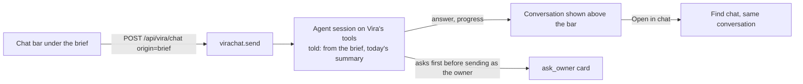

# Brief

Vira > [Modules](../../README.md) > [Attention](../README.md) > Brief

The Daily Brief, its dismissed-row state, and the Journal typed into it.

The brief replaces the cloud email briefing (dead since 2026-05-21)
with a live Vira page: who deserves attention, what is waiting, what is
going quiet. Waiting-on-you and Going-quiet are derived live; dismissals are
the only state. The Journal is what the owner types in.

The chat bar under the brief (Attention > Today) is how the owner asks
Vira, or tells Vira to act, about the day the brief shows. It is Vira's own
chat (Find / Ask, `server/virachat.py`), not a second one: the bar opens a
chat with origin `brief`, which tells the session where the owner is writing
from, hands it today's cached summary, and asks it to confirm before
anything is sent as the owner. One conversation per local day is remembered
on each device; Open in chat continues it in Find.

## What lives here

Everything below is generated from `module.json` and the files themselves. Scripts, assets, tests and documents that belong to this submodule are listed here even while they still sit in the shared top-level folders; see "Moving code" in the root README.

<!-- moduletree:begin - generated by `python -m server.moduletree index --write` from module.json; edit the manifest, not this block -->

**Reads from:** [People / CRM](../../people/crm/README.md), [Incoming / Feed](../../incoming/feed/README.md), [People / Networking](../../people/networking/README.md), [Applications / Catalog](../../applications/catalog/README.md), [Reader / Queue](../../reader/queue/README.md), [Models / Backends](../../models/backends/README.md), [Attention / Assistant](../assistant/README.md), [Incoming / iMessage](../../incoming/imessage/README.md), [Incoming / Mail](../../incoming/mail/README.md), [Find / Notes](../../find/notes/README.md), [Find / Ask](../../find/ask/README.md)

**Feeds:** [Attention / Now](../now/README.md)

### Files (8)

**Server**

| File | What it is |
|---|---|
| `server/brief.py` | Daily Brief: the morning answer to "who and what deserves my attention?" Replaces the cloud email briefing (dead since 2026-05-21) with a live Vira window. |
| `server/briefstate.py` | Dismissed-row state for the Daily Brief. |
| `server/journal.py` | The brief journal: knowledge the owner types INTO the Daily Brief. |
| `server/sourcehealth.py` | Source-health sentinel: "nothing found" must not pass for "nothing there". |

**Tests**

| File | What it is |
|---|---|
| `tests/brief_chat_ui.js` | The brief's chat bar: run the real functions from static/app.js against stub refs and a recorded API, and check what the owner would see and what the server... |
| `tests/test_brief_chat_ui.py` | The Daily Brief's chat bar (Attention > Today): send, steer, follow, the one-chat-per-day rule and a failed send, run in Node against the real functions in s... |
| `tests/test_brief_edit.py` | Interactive-brief tests: targeted loop close/edit (the write path the brief rows use), owner-told facts (stamped for refresh survival), the dismissed-row sto... |
| `tests/test_sourcehealth.py` | The source-health sentinel: a zero against a busy baseline is labelled broken, everywhere an answer from that source surfaces, and one fix-it item is filed p... |

### Routes (11)

Prefixes: `/api/brief$`, `/api/brief/dismiss`, `/api/brief/journal`, `/api/brief/loop`, `/api/brief/narrative`, `/api/brief/note`, `/api/health/sources`

- `GET /api/brief`
- `POST /api/brief/narrative`
- `POST /api/brief/loop`
- `POST /api/brief/dismiss`
- `POST /api/brief/note`
- `GET /api/brief/journal/export`
- `GET /api/brief/journal`
- `POST /api/brief/journal/resolve`
- `POST /api/brief/journal/resolve-all`
- `GET /api/health/sources`
- `POST /api/health/sources/check`

### Stores (3)

Instance state under git-ignored `data/`; never hand-edit (see `AGENTS.local.md`, section 5).

- `data/brief-state.json`
- `data/journal.json`
- `data/source-health.json`

### System map

Registry records in `server/modulemap.py` (the System Map window renders them): `brief-engine`, `journal-win`

### Agent brief

`python -m server.moduletree brief attention/brief` prints this page and the full module docstring of every server file above.

<!-- moduletree:end -->
