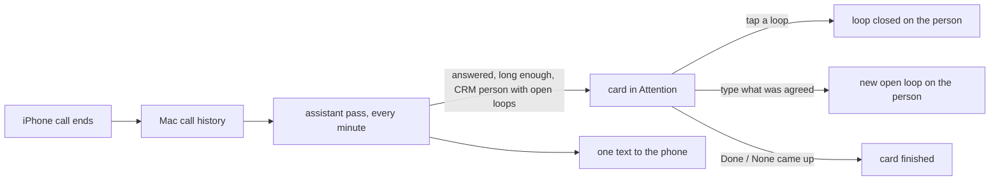

# After a call

Vira > Modules > Attention > After a call

When a phone or FaceTime call of a few minutes ends with someone who has
open loops, Vira puts one card in Attention and texts the same question
once (outside quiet hours): "You just talked to David for 14 min. Did you
cover any of these?" Each open loop is a tap-to-close item, and a box adds
anything new that was agreed as a new open loop on that person.

The calls come from the Mac's call history, which the iPhone syncs into;
the store is read-only and needs Full Disk Access. The assistant's minute
timer runs the pass. Config > Assistant turns it off
(`call_loops_enabled`) and sets the shortest call asked about
(`call_loops_min_minutes`).

<!-- moduletree:begin - generated by `python -m server.moduletree index --write` from module.json; edit the manifest, not this block -->

**Reads from:** [Core / Settings](../../core/settings/README.md), [People / CRM](../../people/crm/README.md)

**Feeds:** [Attention / Review](../review/README.md), [People / CRM](../../people/crm/README.md)

### Files (3)

**Server**

| File | What it is |
|---|---|
| `server/callhistory.py` | The Mac's call history: phone and FaceTime calls, read-only. |
| `server/callloops.py` | After a call: ask whether it covered the open loops with that person. |

**Tests**

| File | What it is |
|---|---|
| `tests/test_callloops.py` | After-call cards, end to end on synthetic data. |

### Routes (4)

Prefixes: `/api/calls`

- `GET /api/calls`
- `POST /api/calls/check`
- `POST /api/calls/asks/{ask_id}/close`
- `POST /api/calls/asks/{ask_id}/add`

### Stores (1)

Instance state under git-ignored `data/`; never hand-edit (see `AGENTS.local.md`, section 5).

- `data/call-loops.json`

### System map

No registry record of its own yet; it is described by its module's records.

### Agent brief

`python -m server.moduletree brief attention/calls` prints this page and the full module docstring of every server file above.

<!-- moduletree:end -->
