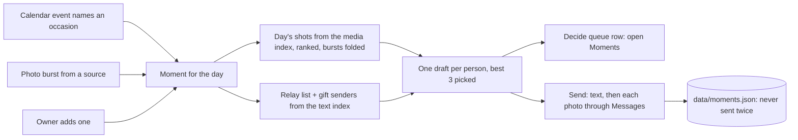

# Moments

Vira > [Modules](../../README.md) > [Attention](../README.md) > Moments

Family moments: a family event's best shots, relayed to the people who would want them.

When a family event happens (a parade, a recital, a first day of school),
Vira finds the day's photos and videos from the owner's chosen sources,
ranks them, suggests who would want them (the owner's relay list, plus
anyone who sent a gift for the occasion) and drafts one short message per
person with the best shots attached, ready to send with one tap. The setup
is the owner's; the product never assumes a family member or an occasion.

## What lives here

Everything below is generated from `module.json` and the files themselves. Scripts, assets, tests and documents that belong to this submodule are listed here even while they still sit in the shared top-level folders; see "Moving code" in the root README.

<!-- moduletree:begin - generated by `python -m server.moduletree index --write` from module.json; edit the manifest, not this block -->

**Reads from:** [Core / Settings](../../core/settings/README.md), [Find / Media](../../find/media/README.md), [Incoming / Feed](../../incoming/feed/README.md)

**Feeds:** [Attention / Review](../review/README.md), [Incoming / Feed](../../incoming/feed/README.md)

### Files (2)

**Server**

| File | What it is |
|---|---|
| `server/moments.py` | Family moments: when a family event happens, relay the day's best shots to the people who would want them. |

**Tests**

| File | What it is |
|---|---|
| `tests/test_moments.py` | Family moments, end to end on synthetic data. |

### Routes (6)

Prefixes: `/api/moments`

- `GET /api/moments`
- `PUT /api/moments/setup`
- `POST /api/moments`
- `PUT /api/moments/{moment_id}/recipient`
- `POST /api/moments/{moment_id}/send`
- `POST /api/moments/{moment_id}/dismiss`

### Stores (1)

Instance state under git-ignored `data/`; never hand-edit (see `AGENTS.local.md`, section 5).

- `data/moments.json`

### System map

No registry record of its own yet; it is described by its module's records.

### Agent brief

`python -m server.moduletree brief attention/moments` prints this page and the full module docstring of every server file above.

<!-- moduletree:end -->
