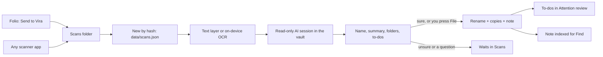

# Scans

Vira > [Modules](../../README.md) > [Incoming](../README.md) > Scans

Paper from the scanner: read by an AI session, renamed, copied into the vault folders it belongs in, summarised, and its to-dos listed.

Paper mail is a channel like any other. The scanner (Folio, the native
webcam scanner in `macos/scanner/`, or any app that saves PDFs or pictures)
saves each finished document into one folder, the `scans_folder` setting.
Vira notices the new file, reads its text (the PDF's own text layer, or
on-device OCR), and starts one read-only agent session in the vault that
holds the folder. The session looks at the pages, searches the vault and
the CRM for context, and answers with a filing decision: a name, a summary,
up to three folders, and dated to-dos quoted from the page. Vira then files
it itself through the governed vault writer: renames the scan, saves a
byte-identical copy in each folder, writes a source-summary note, and puts
each to-do in Attention's review list. Every filing can be undone.

A decision is filed without asking (`scans_auto`) only when the reader is
sure and asked nothing; an edited decision is always filed by hand. Only
the instance holding the automation lease reads and files on its own.

On the same Mac, **Show in Fractal** opens a filed scan at its original
location, or at the saved copy selected under **Copies saved in**. Fractal
Hybrid must already know the workspace containing that file.

<!-- moduletree:begin - generated by `python -m server.moduletree index --write` from module.json; edit the manifest, not this block -->

**Reads from:** [Core / Settings](../../core/settings/README.md), [Models / Sessions](../../models/sessions/README.md), [Work / Sessions](../../work/sessions/README.md)

**Feeds:** [Attention / Review](../../attention/review/README.md), [Find / Notes](../../find/notes/README.md)

### Files (31)

**Server**

| File | What it is |
|---|---|
| `server/scanroutes.py` | HTTP surface for Scans (server/scans.py). |
| `server/scans.py` | Scans - paper documents from the scanner, read, named, filed and summarised. |

**Frontend**

| File | What it is |
|---|---|
| `static/scans.css` | Scans: paper from the scanner, read, named and filed (static/scans.js). |
| `static/scans.js` | Scans - paper documents from the scanner, read, named and filed. |

**Tests**

| File | What it is |
|---|---|
| `tests/test_scans.py` | Scans: arrive, read, file, undo - against a temporary vault. |

**Other**

| File | What it is |
|---|---|
| `macos/scanner/.gitignore` |  |
| `macos/scanner/Package.swift` |  |
| `macos/scanner/README.md` | Vira's document scanner: a native macOS app for USB webcams, built with SwiftUI, AVFoundation, Vision, Core Image, and PDFKit. |
| `macos/scanner/Resources/Folio.entitlements` |  |
| `macos/scanner/Resources/Folio.icns` |  |
| `macos/scanner/Resources/Info.plist` |  |
| `macos/scanner/Sources/Folio/AppModel.swift` |  |
| `macos/scanner/Sources/Folio/CameraController.swift` |  |
| `macos/scanner/Sources/Folio/CameraStreamPlan.swift` |  |
| `macos/scanner/Sources/Folio/CaptureShortcut.swift` |  |
| `macos/scanner/Sources/Folio/ContentView.swift` |  |
| `macos/scanner/Sources/Folio/FolioApp.swift` |  |
| `macos/scanner/Sources/Folio/ImageProcessor.swift` |  |
| `macos/scanner/Sources/Folio/Models.swift` |  |
| `macos/scanner/Sources/Folio/NativeViews.swift` |  |
| `macos/scanner/Sources/Folio/PDFExporter.swift` |  |
| `macos/scanner/Sources/Folio/ScanExport.swift` |  |
| `macos/scanner/Sources/Folio/SessionStore.swift` |  |
| `macos/scanner/Sources/Folio/ViraLink.swift` |  |
| `macos/scanner/Tests/FolioTests/CameraStreamPlanTests.swift` |  |
| `macos/scanner/Tests/FolioTests/ScannerTests.swift` |  |
| `macos/scanner/Tests/FolioTests/ViraLinkTests.swift` |  |
| `macos/scanner/Tests/FolioTests/WorkflowTests.swift` |  |
| `macos/scanner/scripts/build.sh` |  |
| `macos/scanner/scripts/make-icon.swift` |  |
| `macos/scanner/scripts/test.sh` | Standalone Command Line Tools ship Testing.framework outside Swift's default search path. |

### Routes (15)

Prefixes: `/api/scans`

- `GET /api/scans` (server/scanroutes.py)
- `GET /api/scans/config` (server/scanroutes.py)
- `POST /api/scans/look` (server/scanroutes.py)
- `POST /api/scans/arrived` (server/scanroutes.py)
- `POST /api/scans/open-scanner` (server/scanroutes.py)
- `GET /api/scans/{sid}` (server/scanroutes.py)
- `GET /api/scans/{sid}/file` (server/scanroutes.py)
- `GET /api/scans/{sid}/thumb` (server/scanroutes.py)
- `GET /api/scans/{sid}/page/{n}` (server/scanroutes.py)
- `POST /api/scans/{sid}/read` (server/scanroutes.py)
- `PUT /api/scans/{sid}/decision` (server/scanroutes.py)
- `POST /api/scans/{sid}/file` (server/scanroutes.py)
- `POST /api/scans/{sid}/undo` (server/scanroutes.py)
- `POST /api/scans/{sid}/ignore` (server/scanroutes.py)
- `POST /api/scans/{sid}/action` (server/scanroutes.py)

### Stores (2)

Instance state under git-ignored `data/`; never hand-edit (see `AGENTS.local.md`, section 5).

- `data/scans.json`
- `data/scans/thumbs/`

### System map

No registry record of its own yet; it is described by its module's records.

### Agent brief

`python -m server.moduletree brief incoming/scans` prints this page and the full module docstring of every server file above.

<!-- moduletree:end -->
