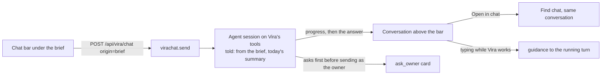
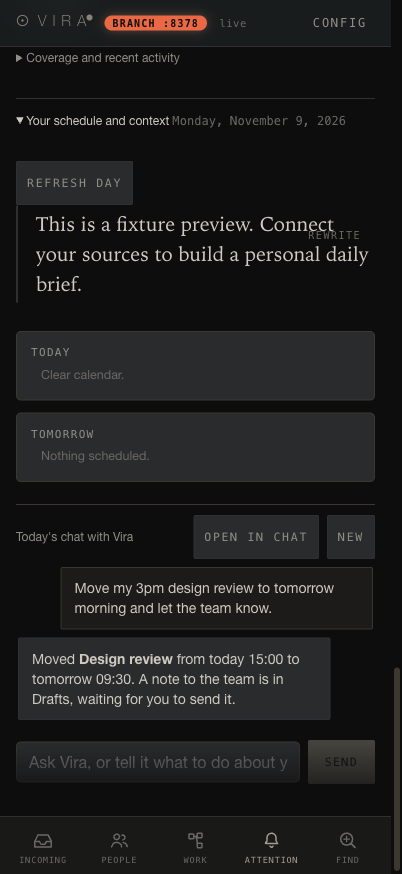

# Chat bar under the daily brief

A chat bar at the bottom of Attention > Today lets the owner ask Vira, or
tell Vira to act, about the day the brief shows. It is Vira's own chat (the
one in Find), not a second one: the bar opens a chat with origin `brief`, so
the session is told the owner is writing from the brief, is handed today's
summary, and confirms before anything is sent as the owner. One
conversation per local day is remembered on each device; Open in chat
continues it in Find. Code: `server/virachat.py` (`ORIGINS`,
`_origin_context`) and the "brief's chat bar" block in `static/app.js`.

Screenshots use a synthetic conversation injected into the real renderer on
a fixture test instance; no owner data appears in them.
