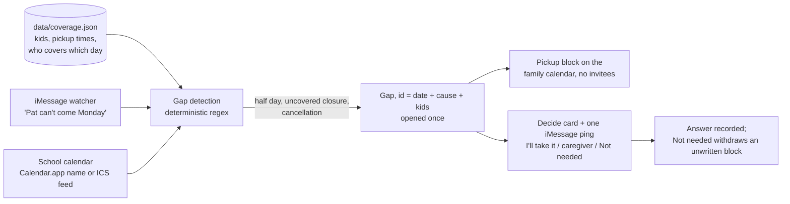
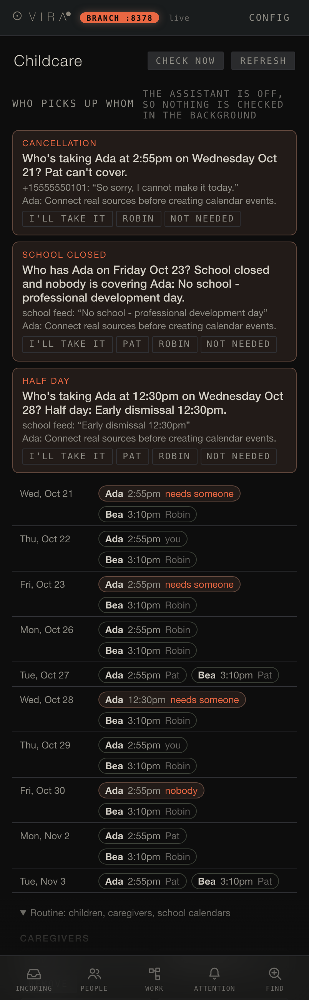

# Childcare coverage gaps

The owner enters each child's pickup time and who normally covers each
school day in the Childcare window. Vira watches three things against that
routine: a caregiver cancelling in iMessage, a half day on a school
calendar, and a closure on a day nobody covers. Each gap gets one timed
pickup block on the family calendar and one "who's taking it?" question,
asked once. Code: `server/coverage.py`; calendar path `plan_coverage` in
`server/calendarplan.py`; Decide card in `server/reviewqueue.py`; window in
`static/app.js` (`renderCoverage`).

Screenshots come from a fixture test instance with a synthetic routine
(children Ada and Bea, caregivers Pat and Robin), a synthetic ICS feed served
on localhost, and synthetic messages. Calendar writes are refused in fixture
mode, which is the "Connect real sources" line on each card.
