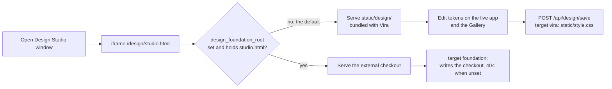

# Design Studio ships with Vira

The Design Studio window frames `/design/studio.html`. That page used to
live only in a separate design-system checkout (config
`design_foundation_root`, default `~/workspace/design-foundation`). A fresh
install had no way to get that checkout, so the window showed its skins and
background pickers above an empty 404 frame. The studio is now bundled in
`static/design/` and works on first open with no setup. A configured
checkout that holds a `studio.html` still takes precedence. The folder is
picked on every request, so a checkout cloned while Vira runs is served
without a restart, and `GET /api/design/status` names which copy is served.
Code: `server/designstudio.py` (`serve_root`, `status`, `CheckoutFiles`),
the `/design` mount in `server/main.py`.

