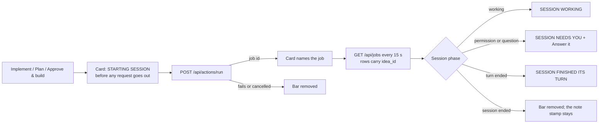

# Live session banner on an idea card

A session started from an idea used to show up on the idea only as a
"dispatched implement ..." stamp in the faint meta line, written after the
launch request returned, so it arrived late and read as metadata. Now the
card carries a bold bar from the moment Implement, Plan or Approve & build
is pressed, and the bar tracks the session until it ends.
Code: `ideaSessionBanner` / `syncIdeaLive` and `dispatchIdeaRun` in
`static/app.js`; `.idea-live*` in `static/style.css`; `idea_id` on each row
of `GET /api/jobs` (`Sessions.recent` in `server/session.py`).

The screenshot runs the real `jobPhase` and `ideaSessionBanner` from
`static/app.js` against the real stylesheet with synthetic ideas and jobs;
no owner data appears in it.
