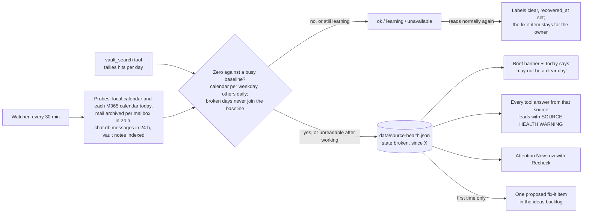

# Source-health sentinel

"Nothing found" used to read the same as "nothing there": a calendar that
stopped syncing gave a "Clear calendar." brief, and a dead mailbox gave
"no matches". The sentinel learns a baseline per source and, when a source
reads zero against it, labels everything drawn from that source "looks
broken since X" and files one fix-it item.
Code: `server/sourcehealth.py`; wiring in `server/brief.py`,
`server/viratools.py` (`invoke`), `server/attention.py` and
`renderSourceHealth` in `static/app.js`.

The screenshot runs the real `renderSourceHealth` from `static/app.js`
against the real stylesheet with synthetic rows; no owner data appears in it.

Rules worth knowing:

- No verdict without a baseline: 3 clean same-weekday readings for the
  calendar, 5 clean days for the rest. A source that never read above zero
  is `unavailable`, not broken.
- A quiet source is never broken: the usual median must reach 3 (1 for
  vault notes) before a zero counts.
- Mail is counted from the mail archive (the watcher's feed starts empty at
  every boot); with the archive off, mail reads `unavailable`.
- `GET /api/health/sources` reads the verdicts; `POST
  /api/health/sources/check` (the Recheck buttons) probes now.
  CLI: `python -m server.sourcehealth status|check [--no-file]`.
